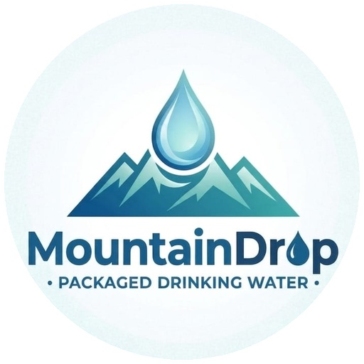

# Mountain Drop - Premium Packaged Drinking Water & Custom Branded Bottles

Mountain Drop supplies custom branded water bottles and premium packaged drinking water for hotels, restaurants, resorts, events, and businesses in Pune, Mulshi, and across Maharashtra.

## Technologies Used

* **HTML5**: Semantic and SEO-optimized structures.
* **Vanilla CSS3**: High-performance, modern styles with modular tokens.
* **Vanilla JavaScript**: Dynamic mobile responsive navigation toggle and scroll interactivity.
* **SEO Best Practices**: Microdata schema markup (LocalBusiness, FAQPage), structured Open Graph, and responsive tags.

## Folder Structure

```
project-root/
│
├── index.html           # Homepage (Hero, Trust Bar, Process, FAQ, CTA)
├── services.html        # Detailed services (Hotel, Restaurant, Event, Bulk supply)
├── about.html           # About us & Why Mountain Drop advantages
├── products.html        # Our Work/Partners portfolio (Taste of Tamhini, Custom Branding)
├── contact.html         # Contact numbers (Yash, Niraj) and direct quote links
│
├── css/
│   └── style.css        # Extracted, central styling sheets
│
├── js/
│   └── script.js        # Mobile menu toggle and scroll shadow control
│
├── images/              # Optimized assets and custom branding mockups
│   ├── logo.jpeg
│   ├── Bottle.png
│   ├── TasteOfTamhini.jpeg
│   ├── bottle-2.jpeg
│   └── bottle-3.jpeg
│
├── .gitignore           # Excludes IDE and local system files from Git
├── robots.txt           # Search Engine crawler indexing rules
├── sitemap.xml          # Indexed routes mapping for search engines
└── README.md            # Project and deployment documentation
```

## How to Run Locally

Since this is a lightweight, static HTML/CSS/JS website, you do not need a complicated build tool setup.

### Method 1: Double-click HTML
1. Double-click `index.html` inside this directory to open it in your browser.
2. Note that file links between pages will work seamlessly.

### Method 2: Live Server (Recommended)
1. If using VS Code, install the extension **Live Server**.
2. Right-click on `index.html` and select **Open with Live Server**.
3. It will host the site at `http://127.0.0.1:5500/` and auto-reload on changes.

---

## How to Deploy to Vercel

Vercel is the easiest way to deploy static websites.

### Step 1: Push to GitHub
1. Create a repository on GitHub.
2. In your terminal, initialize Git, commit, and push this folder:
   ```bash
   git init
   git add .
   git commit -m "Initial organized commit"
   git branch -M main
   git remote add origin YOUR_GITHUB_REPOSITORY_URL
   git push -u origin main
   ```

### Step 2: Import into Vercel
1. Log in to [Vercel](https://vercel.com).
2. Click **Add New** -> **Project**.
3. Import your GitHub repository.
4. Keep the default settings (Vercel automatically detects the static HTML project).
5. Click **Deploy**.
6. Your live site URL will be ready in under a minute!

---

## Image Folder Usage

* All images must be placed inside the `images/` directory.
* Use relative paths to reference them in your HTML:
  ```html
  
  ```
* Do not use absolute local computer paths (like `C:\Users\...` or `file:///C:/...`).

---

## How to Update the Website

1. Modify your HTML files or CSS/JS styles locally.
2. Commit and push the changes to GitHub:
   ```bash
   git add .
   git commit -m "Update website styling"
   git push
   ```
3. Vercel will automatically detect the push and redeploy the update in the background!
